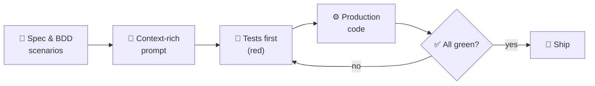
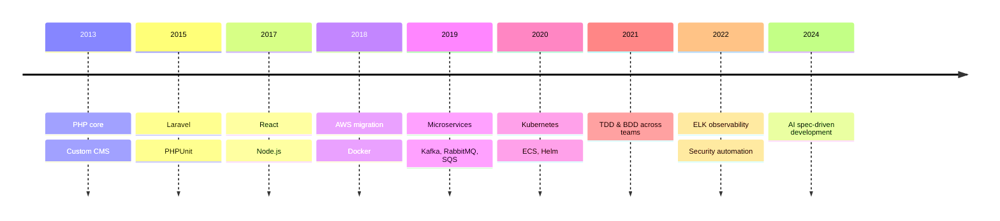

<p align="center">
  <a href="https://vineshgoyal.online">
    
  </a>
</p>

<p align="center">
  <a href="https://vineshgoyal.online"></a>
  <a href="https://www.linkedin.com/in/vineshgoyal/"></a>
  <a href="mailto:contact@vineshgoyal.online"></a>
</p>

<p align="center">
  
  
  
  
</p>

## 👨‍💻 About me

```ts
const vinesh = {
  role:      "Senior Full-Stack Architect",
  basedIn:   "India 🇮🇳",
  since:     2013,
  builds:    ["distributed systems", "cloud-native AWS microservices", "products that ship"],
  believes:  "tests first, then code. Specs first, then AI.",
  currently: "pairing AI coding agents with strict specs and automated tests",
  openTo:    ["architecture consulting", "full-stack builds", "team quality coaching"],
};
```

## 🚀 Live in production

<table>
  <tr>
    <td width="50%" valign="top">
      <h3>🏋️ <a href="https://tanksgym.in/">TanksGym</a></h3>
      <sub><b>Custom CRM &amp; website</b></sub>
      <p>A gym chain that outgrew WordPress, rebuilt from scratch on Laravel as a super-light site with its own CRM for every enquiry. No plugins, no page builder.</p>
      
      
      
    </td>
    <td width="50%" valign="top">
      <h3>📸 <a href="https://feedsetu.vineshgoyal.online/">FeedSetu</a></h3>
      <sub><b>SaaS widget</b></sub>
      <p>A live Instagram feed for any website, installed with one line of HTML. Posts, Reels or both, as a grid, carousel, masonry or slider.</p>
      
      
    </td>
  </tr>
  <tr>
    <td width="50%" valign="top">
      <h3>🚗 <a href="https://noor.vineshgoyal.online/">Noor Auto Accessories</a></h3>
      <sub><b>Online store</b></sub>
      <p>A storefront for an auto-parts retailer: categorised catalogue, product variants, offer pricing, live stock status and a cart.</p>
      
      
    </td>
    <td width="50%" valign="top">
      <h3>🦷 <a href="https://dental3.videsolutions.in/">SmileCraft Dental</a></h3>
      <sub><b>Clinic website &amp; booking</b></sub>
      <p>A family dentistry platform with treatment guides, dentist profiles, patient reviews and online appointment booking.</p>
      
      
    </td>
  </tr>
</table>

## 🛠️ Tech arsenal

<p align="center"><b>Frontend</b><br><br>
  
</p>
<p align="center"><b>Backend &amp; data</b><br><br>
  
</p>
<p align="center"><b>Cloud, DevOps &amp; messaging</b><br><br>
  
</p>

## 🤖 How I ship with AI

AI writes the code; specs and tests decide whether it's right.



## 🧭 The journey so far



<br>

<p align="center"><i>Most of my client work lives in private repos. The case studies are on <a href="https://vineshgoyal.online">vineshgoyal.online</a>.</i></p>


